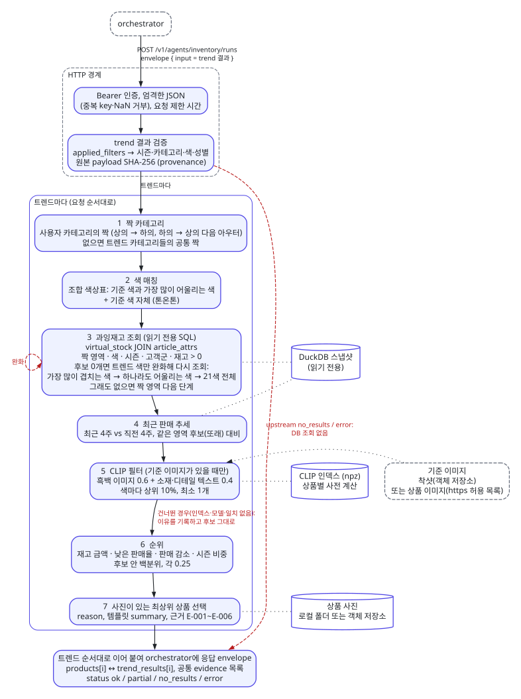
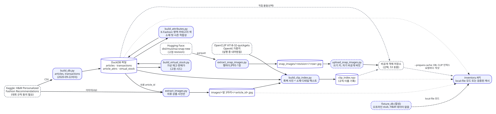

# fashion-planner-inventory

트렌드마다 함께 제안할 과잉재고 상품 1개를 찾습니다. 짝 카테고리, 색 조합, 읽기 전용 DuckDB 스냅샷에 대한 SQL, 선택적인 CLIP 유사도 필터, 근거가 드러나는 과잉재고 순위로 고릅니다.

> 이 레포는 **fashion-planner** 5개 레포 중 하나입니다. 전체 구조와 실행 방법은 [fashion-planner-orchestrator](https://github.com/KG-RAG-02/fashion-planner-orchestrator)에서 시작하세요.

| 레포 | 역할 |
|---|---|
| [fashion-planner-orchestrator](https://github.com/KG-RAG-02/fashion-planner-orchestrator) | 기획 질의 구조화, 6단계 워크플로 실행, 웹 UI, 기획서 PNG, Docker 통합 배포 |
| [fashion-planner-trend](https://github.com/KG-RAG-02/fashion-planner-trend) | Vogue Korea 기사에서 트렌드 추출, Neo4j 지식 그래프, 유사 상품 검색 |
| **[fashion-planner-inventory](https://github.com/KG-RAG-02/fashion-planner-inventory)** | **트렌드에 맞는 과잉재고 상품 매칭(규칙 + CLIP)** |
| [fashion-planner-novelty](https://github.com/KG-RAG-02/fashion-planner-novelty) | 트렌드 기반 신상품(novelty) 기획안과 제품·착장 이미지 생성 |
| [fashion-planner-research](https://github.com/KG-RAG-02/fashion-planner-research) | 기획안의 판매·시장 조사(가격, 원단 원가, 고객 연령, 타깃) |

## 개요

MD가 "27년 SS 발레코어 상의"를 기획한다고 합시다. trend 서비스는 트렌드와 아이템, 색, 비슷한 상품 이미지를 돌려줍니다. 이 서비스는 트렌드마다 **새 상품과 함께 입을, 재고가 많이 남은 기존 상품 1개**를 고릅니다. 상의를 기획하면 하의에서, 트렌드 색과 어울리는 색으로, 요청 시즌에 팔리던 상품 중에서 고르고 사진과 선택 근거 수치를 함께 돌려줍니다.

- 규칙과 SQL만 씁니다. 언어 모델을 부르지 않으며, 입력과 데이터가 같으면 결과도 같습니다.
- 재고와 판매가는 실제 판매 기록에서 만든 합성 값입니다(`data_nature: sample`). [한계](#한계)를 보세요.
- HTTP API(FastAPI) 하나이고, 부르는 쪽은 orchestrator뿐입니다.

## 아키텍처

<picture>
  <source media="(prefers-color-scheme: dark)" srcset="docs/diagrams/inventory-pipeline-dark.svg">
  
</picture>

데이터는 Kaggle H&M 데이터셋에서 오프라인으로 만들고 커밋하지 않습니다.

<picture>
  <source media="(prefers-color-scheme: dark)" srcset="docs/diagrams/data-build-dark.svg">
  
</picture>

자세히: [docs/architecture.md](docs/architecture.md). 노드와 엣지마다 코드 근거는 [docs/diagrams/CLAIMS.md](docs/diagrams/CLAIMS.md)에 있습니다.

## 기능

- **짝 카테고리**: 기획 카테고리의 짝(상의 → 하의, 하의 → 상의 다음 아우터), 없으면 트렌드 카테고리의 짝.
- **색 매칭**: 수동 조합 색상표로 기준 색과 가장 많이 어울리는 색, 그리고 톤온톤. 사용자 색이 먼저입니다.
- **과잉재고 조회**: 가상 재고와 상품 속성을 조인해 시즌과 고객군으로 거릅니다.
- **정해진 완화**: 후보가 없으면 트렌드 색만 정해진 순서로 넓히고, 시도마다 기록합니다.
- **또래 대비 판매 추세**: 시즌이 끝나 모두 함께 줄어드는 효과를 뺍니다.
- **선택적 CLIP 필터**(OpenCLIP ViT-B/32 QuickGELU, 흑백 이미지 + 소재·디테일 텍스트): 미리 만든 인덱스와 비교하고, 걸 수 없으면 이유를 남기고 건너뜁니다.
- **드러나는 순위**: 재고 금액, 낮은 판매율, 판매 감소, 시즌 비중의 백분위를 같은 가중치로 평균합니다.
- **추적 가능한 출력**: 트렌드마다 `reason` 수치, 문장 틀 `summary`, `limitations`, 근거 항목.
- **운영 장치**: 본문 파싱 전 bearer 인증, 엄격한 JSON, 요청 제한 시간, 읽기 전용 DB, readiness와 liveness 분리, 체크섬으로 검증하는 캐시, 비root 읽기 전용 컨테이너.

전체 규칙: [docs/ranking-rules.md](docs/ranking-rules.md)

## 빠른 시작 (오프라인, 합성 데이터)

Python 3.11 이상이 필요합니다. 데이터·네트워크·GPU 없이 돌아갑니다. CLIP 인덱스가 없으므로 CLIP 필터는 건너뜁니다.

```bash
git clone https://github.com/KG-RAG-02/fashion-planner-inventory.git
cd fashion-planner-inventory
python -m venv .venv && . .venv/bin/activate
pip install -e ".[dev]"

python -m fashion_planner_inventory.fixture_db /tmp/inventory-fixture.duckdb   # 합성 데이터, H&M 데이터 없음
export FASHION_PLANNER_SERVICE_TOKEN=dev-token                                  # 로컬 확인용 아무 값
INVENTORY_DB_PATH=/tmp/inventory-fixture.duckdb python -m fashion_planner_inventory.server   # http://127.0.0.1:8002
```

다른 터미널에서(같은 `FASHION_PLANNER_SERVICE_TOKEN` 값을 export한 뒤):

```bash
curl -s http://127.0.0.1:8002/health/ready
curl -s -H "Authorization: Bearer $FASHION_PLANNER_SERVICE_TOKEN" -H "Content-Type: application/json" \
  --data @examples/stub/inventory-request.json http://127.0.0.1:8002/v1/agents/inventory/runs
```

기대 결과: HTTP 200, `status: ok`, 상품 1개(`0910001001`, 화이트 스커트), `search.clip.skip_reason: no_index`, DB가 합성 fixture라는 limitations 문장. bearer 헤더가 없으면 401입니다. 기대 응답 요약은 [examples/stub/inventory-response-summary.json](examples/stub/inventory-response-summary.json), OpenAPI 문서는 http://127.0.0.1:8002/docs 입니다.

Docker:

```bash
docker build -t fashion-planner-inventory .
docker run --rm -v /tmp:/fixture fashion-planner-inventory python -m fashion_planner_inventory.fixture_db /fixture/inventory-fixture.duckdb
docker run --rm -p 127.0.0.1:8002:8002 --read-only --tmpfs /tmp -v /tmp/inventory-fixture.duckdb:/data/fixture.duckdb:ro \
  -e INVENTORY_DB_PATH=/data/fixture.duckdb -e FASHION_PLANNER_SERVICE_TOKEN=dev-token fashion-planner-inventory
```

다섯 서비스를 함께 돌리려면 orchestrator의 빠른 시작을 보세요.

## 설정

로컬에서는 `.env.example`을 `.env`로 복사해 씁니다(`.env`는 커밋하지 않습니다). Docker에서는 `--env-file`로 넘깁니다. 프로세스 환경변수가 `.env`보다 우선합니다.

| 변수 | 기본값 | 설명 |
|---|---|---|
| `FASHION_PLANNER_SERVICE_TOKEN` | 없음 | run 경로의 공용 bearer 토큰. 없으면 모든 요청이 401입니다. |
| `INVENTORY_DB_PATH` | 없음 | local-file 모드: 이 DuckDB 파일을 읽기 전용으로 열고 객체 저장소를 쓰지 않습니다. `<파일>.sha256` sidecar가 있으면 확인합니다. |
| `INVENTORY_IMAGE_DIR` | `data/images` | 로컬 상품 사진(`<앞 3자리>/<article_id>.jpg`) |
| `INVENTORY_CLIP_INDEX_PATH` | `data/clip_index.npz` | 로컬 CLIP 인덱스. 없거나 규칙이 다르면 필터를 건너뜁니다(`no_index`). |
| `INVENTORY_HANDOFF_TIMEOUT_SECONDS` | `60` | 요청 전체 제한 시간, (0, 600] 범위. 호출하는 쪽의 읽기 제한 시간보다 짧게 둡니다. |
| `INVENTORY_CACHE_DIR` | 시스템 임시 폴더 아래 `fashion-planner-inventory` | 객체 저장소 모드: 검증된 DB·인덱스 캐시 |
| `INVENTORY_IMAGE_CACHE_DIR` | `$INVENTORY_CACHE_DIR/images` | 받은 사진 캐시. 쓸 수 없으면 캐시 없이 사진을 돌려주고 limitations에 적습니다. |
| `R2_ACCOUNT_ID`, `R2_ENDPOINT`, `R2_BUCKET`, `R2_DB_KEY`, `R2_IMAGE_PREFIX`, `R2_CLIP_INDEX_KEY`, `R2_SNAP_IMAGE_PREFIX`, `R2_ACCESS_KEY_ID`, `R2_SECRET_ACCESS_KEY` | 없음 | 선택: 비공개 S3 호환 버킷(Cloudflare R2에서 확인). 읽기 전용 키를 쓰세요. [docs/cloudflare-r2.md](docs/cloudflare-r2.md) |

CLIP 모델 가중치는 `open_clip`이 처음 모델을 불러올 때 `$HOME` 아래로 내려받습니다(이미지는 `HOME=/tmp`). 컨테이너가 인터넷에 나갈 수 있게 하거나 캐시를 미리 채워 두세요. 로컬에서 필터를 켜려면 `.[clip]`(torch, OpenCLIP)을 설치합니다.

## 데이터

데이터는 포함하지 않습니다. 실제 DB를 만들려면 Kaggle H&M 대회 규칙에 동의한 뒤 데이터를 직접 받아 로컬에서 빌드 스크립트를 돌립니다. 이 데이터는 재배포할 수 없고 MIT 라이선스가 적용되지 않습니다. 착샷 데이터셋은 ID와 revision만 참조합니다. 무신사 상품 이미지는 요청을 처리할 때 받아 임베딩만 하고 저장하지 않습니다. 자세한 조건과 스키마: [docs/data.md](docs/data.md)

## API와 계약

| 메서드 | 경로 | 설명 |
|---|---|---|
| GET | `/health/live` | 프로세스 생존 확인(DB가 없어도 200) |
| GET | `/health/ready` (별칭 `/health`) | DB가 열리고 검사를 통과했으면 200, 아니면 503. CLIP 인덱스 상태는 참고로 표시 |
| POST | `/v1/agents/inventory/runs` | 실행. 본문 `{contract_version: "inventory-handoff", request_id, input: <trend 결과>}`, bearer 필수 |

응답 envelope에는 `producer {agent_id: "inventory", schema_version}`와 `result` 전체가 들어 있습니다. `result`는 `products[i]` ↔ `trend_results[i]`, 공통 `evidence` 목록, `status`(`ok`, `partial`, `no_results`, `error`)로 이루어집니다.

| `errors[].code` | HTTP | 대표 `reason` |
|---|---|---|
| `INVALID_REQUEST` | 400 | `missing_fields`, `invalid_input`, `schema_version_mismatch`, `upstream_error` |
| `UNAUTHORIZED` | 401 | bearer 토큰 없음 또는 불일치 |
| `SOURCE_UNAVAILABLE` | 503 | `db_unavailable`, `image_source_unavailable` |
| `TIMEOUT` | 504 | `timeout` |
| `INTERNAL_ERROR` | 500 | `invalid_response`, `internal` |

일부 트렌드만 실패하면 200에 `status: partial`이고 오류는 트렌드별 `errors`에 있습니다. JSON Schema와 예시: [contracts/](contracts/README.md)

## 프로젝트 구조

```
fashion_planner_inventory/   서비스 코드
  api.py, server.py          HTTP 앱, CLI(--check-ready, --prepare-cache), service-manifest.json
  trend_request.py           trend 결과 → 내부 요청, provenance 해시
  multi.py, agent.py         트렌드별 처리, 응답 조립과 검사
  overstock.py               짝 카테고리, 색, SQL, 판매 추세, 순위
  snap.py, clip_matcher.py, clip_vocab.py   CLIP 기준 이미지와 필터
  attributes.py, season.py, synthetic.py    데이터 규칙
  storage.py, images.py, readiness.py       DB, 사진, readiness 검사
  fixture_db.py              오프라인 stub용 합성 DB
contracts/                   JSON Schema와 예시
examples/                    trend 결과 형식의 요청, stub 요청과 기대 응답 요약
scripts/                     데이터 빌드, CLIP 인덱스, 착샷, 진단, 계약 예시, 다이어그램 렌더
tests/                       오프라인 단위·SQL·API·계약 테스트
docs/                        아키텍처, 랭킹 규칙, 데이터 카드, 트러블슈팅, 결정 기록, 다이어그램
```

## 테스트

```bash
pip install -e ".[dev]"
python -m pytest
```

모든 테스트는 오프라인입니다. 작은 메모리 DuckDB, 가짜 객체 저장소, CLIP 모델 대체를 씁니다. 공개 시점 결과는 392 passed, 0 skipped입니다(Python 3.11·3.12).

## 트러블슈팅과 교훈

torchvision 짝이 맞지 않아 CLIP이 조용히 꺼졌던 일부터 LLM을 뺀 이유까지, 무엇이 왜 고장 났고 어떻게 고쳤는지: [docs/troubleshooting.md](docs/troubleshooting.md). 설계 결정: [docs/decisions/](docs/decisions/)

## 한계

- **합성 재고와 판매가.** 판매 기록만 실제이고 재고·입고량·판매가는 만든 값입니다. 순위는 상대 비교로만 보세요.
- **오래된 데이터.** 판매 기록은 2020-09-22에 끝납니다. 미래 시즌은 2019~2020년의 같은 시즌으로 바꿔 계산합니다.
- **같은 상품 반복.** 순위 지표 4개가 트렌드와 무관하고 트렌드 사이의 중복을 지우지 않아서, 여러 트렌드가 같은 상품을 돌려받을 수 있습니다.
- **CLIP은 상대 필터입니다.** 색마다 상위 10%를 남기므로 어떤 색에 후보가 1개면 항상 남고, 인덱스에 없는 후보는 0점이며, 흑백에도 명도는 남습니다. 코디 품질에 주는 효과는 평가하지 않았습니다.
- **트렌드마다 상품 1개**, 사이즈 없음, 응답의 카테고리·색 이름과 코드 주석은 한국어입니다.
- **착샷 기준 이미지**는 자기 버킷이 있어야 씁니다. 없으면 착샷은 텍스트만으로 CLIP을 겁니다.

## 감사의 말

- Kaggle의 [H&M Personalized Fashion Recommendations](https://www.kaggle.com/competitions/h-and-m-personalized-fashion-recommendations) 데이터셋(H&M Group).
- Hugging Face의 [`disl/musinsa-snap-new`](https://huggingface.co/datasets/disl/musinsa-snap-new)(ID와 revision만 참조).
- AI Hub K-Fashion 가이드라인(카테고리·색·소재 어휘).
- [OpenCLIP](https://github.com/mlfoundations/open_clip), OpenAI [CLIP](https://github.com/openai/CLIP).
- 폰트: 다이어그램은 [Pretendard](https://github.com/orioncactus/pretendard)(SIL OFL 1.1)로 렌더했습니다. 폰트 파일은 포함하지 않습니다. 아이콘은 쓰지 않았습니다.
- AI 도움: 코드, 테스트, 문서의 일부를 Claude(Anthropic)의 도움을 받아 작성했고 히스토리의 `Co-Authored-By` 줄에 남겼습니다. 모든 변경은 작성자가 검토했습니다.

## 고지

- 이 프로젝트는 학습·교육 목적의 비상업 프로젝트입니다. Condé Nast, Vogue Korea(두산매거진), 무신사, H&M과 관련이 없으며 이들의 승인이나 후원을 받지 않았습니다. 'Vogue'는 해당 권리자의 상표입니다.
- 이 레포에는 제3자 데이터(기사 원문, 이미지, 상품·거래 데이터)가 들어 있지 않습니다. 데이터를 직접 받아 쓰는 경우 각 출처의 이용약관을 따라야 합니다. 자세한 내용은 `docs/data.md`를 보세요.

## 라이선스

코드는 [MIT 라이선스](LICENSE)로 배포합니다. MIT 라이선스는 이 레포의 코드에만 적용되며, 외부 데이터셋과 그 파생물에는 적용되지 않습니다.
