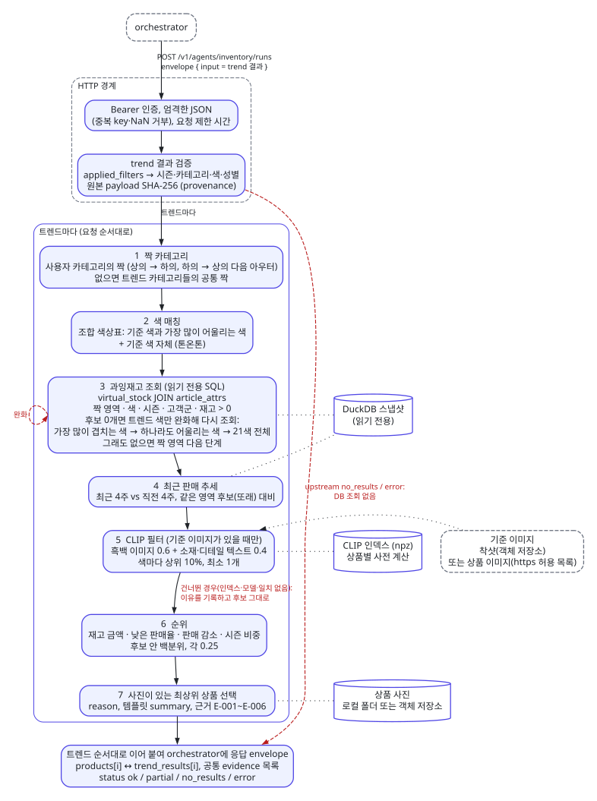
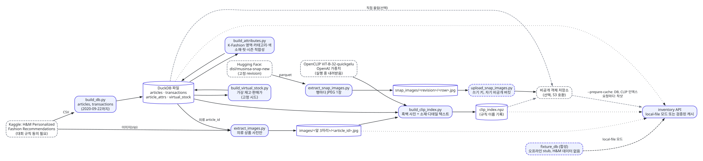

# 아키텍처

## Fashion Planner 안에서의 위치

orchestrator가 서비스들을 차례로 부르고 결과를 넘겨줍니다. 서비스끼리는 서로 부르지 않습니다. inventory 서비스는 두 번째로 불리며, 입력은 trend 서비스의 결과를 바꾸지 않고 orchestrator의 envelope에 넣은 것입니다. 결과는 orchestrator로 돌아가고, orchestrator가 다음 단계에 넘깁니다.

## 요청 처리 흐름

<picture>
  <source media="(prefers-color-scheme: dark)" srcset="diagrams/inventory-pipeline-dark.svg">
  
</picture>

1. **HTTP 경계**(`api.py`). 본문을 읽기 전에 bearer 토큰을 확인합니다. 본문은 중복 key와 유한하지 않은 숫자가 없는 JSON이어야 합니다. 요청 전체 제한 시간을 넘기면 504를 돌려주지만, 이미 시작한 작업을 멈추지는 않습니다.
2. **입력 어댑터**(`trend_request.py`). DB에 접근하기 전에 trend 결과의 버전, 생산자, 형태를 확인하고, `applied_filters`를 내부 요청으로 바꾸고, 원본 trend 결과 본문의 SHA-256을 `input_provenance`에 남깁니다. upstream이 `no_results`나 `error`면 DB를 건드리지 않고 답합니다.
3. **트렌드마다**(`multi.py` → `agent.run_trend`), 요청 순서대로: 짝 카테고리, 색 매칭, 색 완화를 포함한 과잉재고 SQL, 최근 판매 추세, 선택적 CLIP 필터, 순위, 상품 선택. 규칙은 [랭킹 규칙](ranking-rules.md)에 있습니다.
4. **조립**(`multi.py`). 트렌드 순서대로 결과를 이어 붙이고, 근거 ID에 트렌드 이름공간을 붙이고, 돌려주기 전에 응답 전체를 검사합니다(`validate_response`). 형식이 어긋난 응답은 밖으로 나가지 않고 `INTERNAL_ERROR`가 됩니다.

요청들은 읽기 전용 DuckDB 연결 하나를 함께 쓰고, 요청마다 잠금 아래에서 자기 커서를 씁니다.

## 실행 모드

| 모드 | 조건 | DB | 상품 사진 | CLIP 인덱스 | 착샷 |
|---|---|---|---|---|---|
| local-file | `INVENTORY_DB_PATH` 설정 | 그 파일을 읽기 전용으로, sidecar가 있으면 SHA-256 확인 | `INVENTORY_IMAGE_DIR` | `INVENTORY_CLIP_INDEX_PATH` | 없음(착샷은 텍스트만으로 CLIP) |
| 객체 저장소 | `R2_*` 설정, 로컬 경로 없음 | `--prepare-cache`가 채운 캐시, 시작할 때 객체 메타데이터와 대조 | 요청 때 받고 가능하면 캐시 | `--prepare-cache`가 채운 캐시 | 요청 때 `R2_SNAP_IMAGE_PREFIX`에서 읽음 |
| stub | `fixture_db` 출력을 가리키는 local-file | 합성 | 없음 | 없음 | 없음 |

시작할 때는 아무것도 내려받지 않습니다. 준비된 DB가 없으면 `/health/ready`는 503이고 실행 요청은 `SOURCE_UNAVAILABLE`입니다. `/health/live`는 계속 200입니다. CLIP 상태는 `/health`에 표시하지만 readiness 판정에는 쓰지 않습니다.

## 데이터 빌드

<picture>
  <source media="(prefers-color-scheme: dark)" srcset="diagrams/data-build-dark.svg">
  
</picture>

모두 직접 받은 데이터로 자기 컴퓨터에서 돌립니다. [데이터 카드](data.md)를 보세요.

## 컨테이너

`python:3.12-slim`, 같은 인덱스에서 받은 CPU 전용 torch와 torchvision, uid/gid 10001, `HOME=/tmp`, 쓸 수 있는 곳은 `/cache`와 `/models`뿐이고 `/app`에는 쓰지 않습니다. 헬스체크는 `--check-ready`(`GET /health/ready`, 외부 호출 없음)를 부릅니다. 데이터, 사진, 인덱스는 이미지에 넣지 않습니다.

## 다이어그램 원본

`docs/diagrams/src/*.dot`를 `scripts/render_diagrams.sh`(Graphviz, librsvg, Pretendard)가 라이트·다크 SVG와 PNG로 만듭니다. 노드와 엣지마다 코드 근거가 [diagrams/CLAIMS.md](diagrams/CLAIMS.md)에 있습니다.
